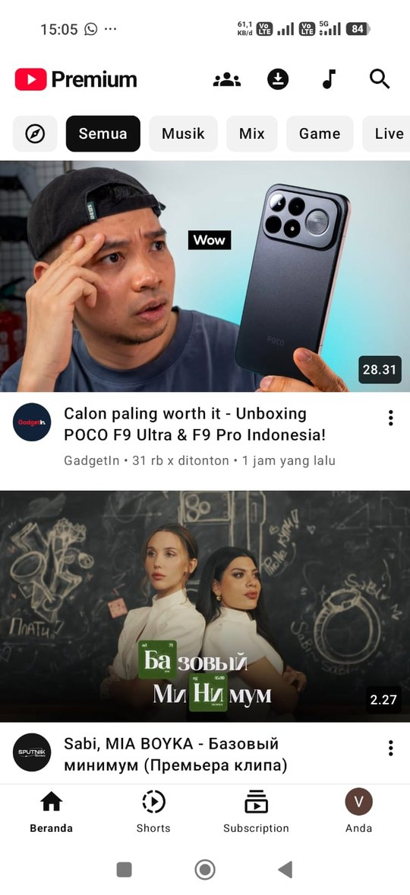
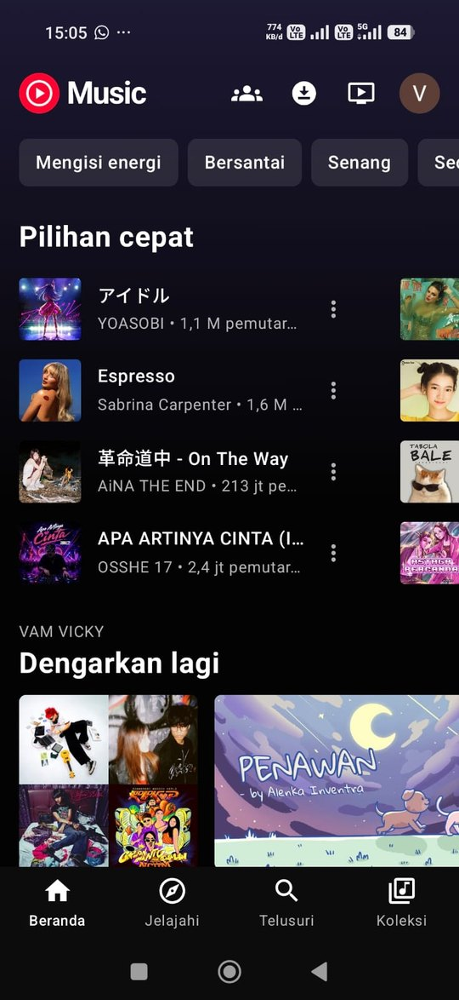
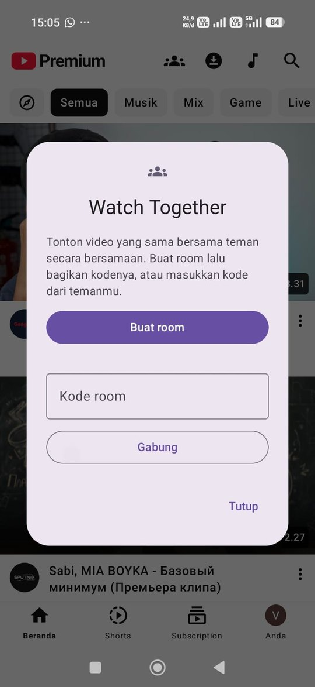
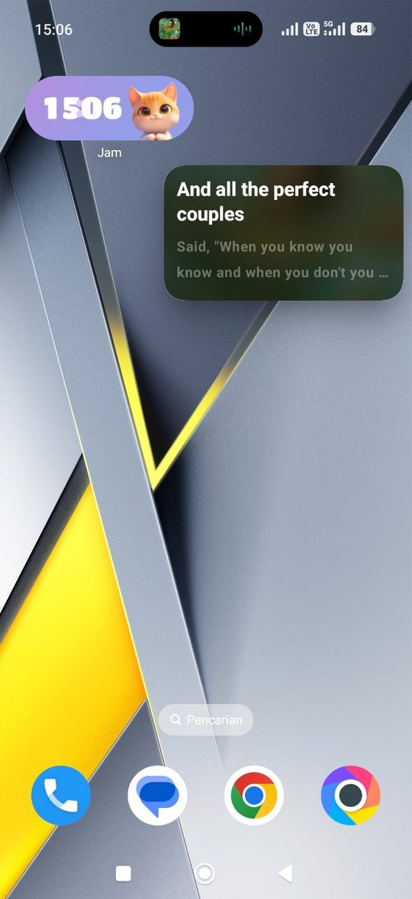

<div align="center">

# ✦ LumiTube ✦

### Klien YouTube & YouTube Music yang ringan untuk Android

*Dua aplikasi · satu kode · sekitar 3 MB per aplikasi · tanpa iklan*

[](https://github.com/vickyvam72/LumiTube/releases/latest)
[](#-kebutuhan-sistem)
[](#%EF%B8%8F-teknologi)
[](LICENSE)
[](#-kenapa-lumitube)

**🌐 Bahasa / Language:** &nbsp; **🇮🇩 Bahasa Indonesia** &nbsp;|&nbsp; [🇬🇧 English](README.en.md)

[⬇️ Unduh](#%EF%B8%8F-unduh--pasang) · [📸 Tampilan](#-tampilan) · [✨ Fitur](#-fitur) · [📖 Panduan](#-panduan-pemakaian) · [❓ FAQ](#-faq--mengatasi-masalah) · [📝 Catatan Perubahan](CHANGELOG.md)

</div>

---

## 🌟 Kenapa LumiTube?

> **YouTube Lumi** dan **YT Music Lumi** bisa melakukan semua yang kamu harapkan dari aplikasi resminya, ditambah beberapa hal yang tidak ada di sana, dengan ukuran sekitar **seperdua puluhnya**.

| | |
|---|---|
| 🪶 **Super ringan** | Tiap APK hanya sekitar **3 MB**. Cepat dibuka, hemat memori dan penyimpanan. |
| 🎤 **Lirik di Picture-in-Picture** | Minimalkan YT Music Lumi dan **lirik sinkron tetap berjalan di jendela kecil mengambang**. Tidak ada di aplikasi resmi. |
| 🎶 **Lirik karaoke per kata** | Mencari di **11 penyedia lirik** sekaligus dan mengutamakan lirik yang sinkron per kata. |
| 🎧 **Putar di latar belakang, layar mati** | Musik dan video tetap jalan saat HP dikunci atau pindah aplikasi. |
| 📥 **Download untuk offline** | Simpan video, lagu, dan **satu playlist penuh**. Download musik **sudah termasuk liriknya**. |
| 🚫 **Tanpa iklan** | Tanpa iklan, analitik, atau pelacak. |
| 📱 **Feed Shorts asli** | Shorts diambil dari mesin rekomendasi YouTube sendiri, disesuaikan dengan akunmu. |
| 👥 **Watch & Listen Together** | Nonton video atau dengar lagu **bareng teman secara bersamaan** dari HP masing-masing, cukup dengan kode room. |
| 🌐 **16 bahasa** | Tampilan aplikasi dan subtitle dalam **16 bahasa** (bawaan English), termasuk Bahasa Indonesia. Judul dan audio video tetap asli. |
| 🔴 **Download live** | Rekam **siaran live yang sedang berjalan**, dari awal live atau mulai dari detik ini. |
| 🎨 **Terang, gelap, atau biru Lumi** | Pilih tema terang atau gelap, dan nyalakan **warna biru Lumi** kalau ingin tampilan seperti logonya. |
| 🔁 **Pulih otomatis** | Internet putus? Lagu lanjut diputar dan liriknya dimuat ulang begitu koneksi kembali. |
| 👤 **Akun tersinkron** | Login dengan Google untuk melihat subscription, playlist, suka, Tonton nanti, dan histori. |

---

## 📸 Tampilan

<div align="center">

| ▶️ YouTube Lumi | 🎵 YT Music Lumi |
|:-:|:-:|
|  |  |
| **Beranda yang terasa seperti rumah sendiri.** Rekomendasi dari akunmu, thumbnail besar, filter kategori, dan **tanpa satu pun iklan**. | **Musikmu, langsung siap diputar.** Pilihan cepat, mood, dan "Dengarkan lagi" persis seperti YT Music, cukup **3 MB**. |

| 👥 Watch & Listen Together | 🎤 Lirik di Picture-in-Picture |
|:-:|:-:|
|  |  |
| **Jarak bukan lagi alasan.** Buat room, bagikan kodenya, lalu nonton atau dengar lagu yang sama **di detik yang sama** dari HP masing-masing. | **Lirik ikut ke mana pun kamu pergi.** Keluar dari aplikasi, lirik sinkron tetap mengambang di layar. **Tidak ada di aplikasi resmi.** |

</div>

---

## 📦 Dua Aplikasi

| | Aplikasi | Paket | Untuk |
|:-:|---|---|---|
| ▶️ | **YouTube Lumi** | `com.lumitube.app` | Video, Shorts, siaran langsung, channel, dan subscription |
| 🎵 | **YT Music Lumi** | `com.lumitube.music` | Lagu, album, artis, playlist, lirik, dan musik offline |

Keduanya bisa dipasang bersamaan dan berjalan sendiri-sendiri. Kamu juga bisa mengirim video dari satu aplikasi ke aplikasi lainnya.

---

## ✨ Fitur

### ▶️ YouTube Lumi

**🎬 Pemutar video**
- Kontrol gaya YouTube: **ketuk dua kali** untuk lompat ±10 detik, **tekan lama** sisi kiri atau kanan untuk **kecepatan 2×**
- **Bab (chapter)** di garis waktu dan **pratinjau gambar** saat menggeser
- Kualitas, kecepatan, ulang, **subtitle dengan terjemahan otomatis**, dan trek audio asli
- **Picture-in-Picture** dan putar di latar belakang
- Layar penuh dengan panel **live chat** di samping, dan **judul video** tampil bersama tombol kontrol

**📱 Shorts**
- Feed vertikal layar penuh dari **rekomendasi asli YouTube**
- Kontrol sama seperti pemutar video: geser dengan pratinjau, tahan untuk 2×, teks, dan kualitas
- Komentar, suka, subscribe, bagikan, dan download langsung dari pemutar
- Posisi Shorts tetap diingat saat kamu membuka channel lalu kembali

**📺 Channel**
- Banner, foto, @handle, jumlah subscriber dan video, deskripsi, dan link
- Tab: **Video · Shorts · Live · Rilis · Playlist · Postingan** (hanya yang dimiliki channel itu)
- Urutan: **Terbaru · Populer · Terlama**
- Halaman **selengkapnya** dengan link yang bisa diklik, negara, tanggal bergabung, dan total penayangan
- Postingan dengan **link yang bisa diklik** dan **gambar layar penuh yang bisa di-zoom**
- Terus dimuat saat di-scroll, dengan tanda *"Tidak ada konten lain lagi"* di ujungnya

**🔎 Pencarian**
- Filter: **Semua · Video · Shorts** (Shorts tampil sebagai grid 3 kolom)
- Kartu channel dengan tombol **Subscribe** dan **Lihat Channel**
- Saran pencarian dan histori pencarian di HP
- Hasil tetap di tempatnya setelah kamu menonton video

**📚 Koleksi dan akun**
- Beranda dengan tarik-untuk-refresh, posisi scroll tetap diingat
- Subscription, **histori per hari** (Semua / Video / Shorts), Video yang disukai, dan Tonton nanti
- **Menu ⋮** di setiap video: Tambahkan ke playlist · Download · Bagikan · Dengarkan di YT Music Lumi
- Menu ⋮ di playlist: Download semua · Bagikan · Hapus playlist
- Lencana hijau **Khusus anggota** pada video yang hanya tersedia untuk anggota channel
- Buat playlist, atur urutannya dengan seret dan lepas, dan hapus playlist milikmu (sinkron dengan YouTube asli; playlist otomatis seperti Recap tidak bisa dihapus)

**🔴 Siaran langsung**
- Tanda live, tombol lompat ke bagian live, dan **live chat real-time**
- **Download live yang sedang berjalan**: rekam dari awal live atau mulai dari detik ini, lalu tekan **Berhenti & simpan** kapan saja (atau rekaman tersimpan otomatis saat live selesai)
- Live yang tidak bisa diputar ulang: garis merah diam di ujung dan tidak bisa digeser

### 🎵 YT Music Lumi

**🎤 Lirik**
- **Lirik karaoke sinkron per kata** dari 11 penyedia: BetterLyrics, BetterLyrics QQ, YouLyPlus, LyricsPlus, Unison, SimpMusic, BiniLyrics, lrc.red, LRCLIB, KuGou, dan YouTube Music
- **🪟 Lirik di Picture-in-Picture** saat aplikasi diminimalkan
- **Lirik offline** untuk lagu yang di-download, dilengkapi otomatis saat internet kembali
- Pilih penyedia lirik favorit, atau cari ulang lirik lagu mana pun

**🎧 Mendengarkan**
- Pencarian seperti YouTube Music: hasil teratas, Lagu, Artis, Album, Playlist komunitas, dan Video
- Antrean radio, ulangi satu / ulangi semua
- **Lanjut otomatis** setelah internet putus atau audio terganggu
- **Timer tidur**

**📂 Koleksi**
- Playlist, album, dan lagu yang kamu sukai
- Menu ⋮ di setiap lagu: Tambahkan ke playlist · Download · Bagikan
- Menu ⋮ di playlist dan album (juga di hasil pencarian dan di pojok kanan atas halaman album/playlist): simpan seluruh isinya ke playlist kamu · Download semua · Bagikan
- Atur urutan dengan seret, hapus lagu, dan hapus playlist milikmu (playlist otomatis seperti Recap tidak bisa dihapus, sama seperti YT Music asli)
- **Download satu playlist penuh** sekali tekan (disimpan sebagai audio)
- Pilihan download dimulai dari **audio**, baru video

### 🧩 Ada di kedua aplikasi

- 📥 Halaman **Download** dengan koleksi otomatis (Lagu / Video) dan playlist yang di-download
- 🔔 Satu notifikasi progres yang rapi untuk tiap download massal
- 👥 **Watch Together** (YouTube Lumi) dan **Listen Together** (YT Music Lumi): buat room, bagikan kode 6 huruf, dan semua peserta memutar video atau lagu yang sama secara bersamaan. Bawaannya hanya pembuat room yang memilih, dengan opsi agar anggota juga bisa memilih
- 🔗 Buka link YouTube / YouTube Music langsung di Lumi
- 🛡️ **Laporan crash** bawaan dengan tombol *"Salin laporan"*
- 🌐 **16 bahasa** aplikasi & subtitle (bawaan English)
- 🌗 Tema **terang/gelap** (bawaan: YouTube Lumi terang, YT Music Lumi gelap) dan **warna biru Lumi** (aktif secara bawaan, bisa dimatikan)
- 📶 Pop up kecil **"Kamu sedang offline"** saat internet putus, juga di mode PiP
- ⏹️ Tombol **Tutup** di notifikasi pemutar (jendela PiP ikut tertutup)
- ⏸️ **Hentikan** download playlist kapan saja dari aplikasi atau notifikasi; yang sudah selesai tetap tersimpan
- ⚙️ **Setelan dalam satu layar**, tanpa scroll

---

## ⬇️ Unduh & Pasang

1. Buka halaman **[Releases](https://github.com/vickyvam72/LumiTube/releases/latest)**.
2. Di bagian **Assets**, unduh salah satu atau kedua aplikasi:
   - `YouTubeLumi-v2.2.apk` untuk YouTube
   - `YTMusicLumi-v2.2.apk` untuk YouTube Music
3. Buka file yang sudah diunduh. Kalau Android meminta, izinkan **"Instal aplikasi tidak dikenal"** untuk browser atau pengelola file yang kamu pakai.
4. Tekan **Instal**. Selesai! 🎉

> 💡 **Update:** Cukup pasang APK baru di atas yang lama. Login, download, dan pengaturanmu tetap aman.

### 📋 Kebutuhan Sistem
- Android **7.0 (API 24)** atau lebih baru
- Ruang kosong sekitar **10 MB** per aplikasi (ditambah ruang untuk download)
- Koneksi internet (kecuali untuk konten yang sudah di-download)

---

## 📖 Panduan Pemakaian

### 0️⃣ Pertama kali dibuka
Saat pertama dipasang, LumiTube menampilkan dua layar singkat, masing-masing pas dalam satu layar tanpa perlu scroll:
1. **Perkenalan**: bahasa bawaannya English. Ketuk tombol bahasa 🌐 di pojok kanan atas untuk memilih **Bahasa Indonesia** atau bahasa lain. Lalu pilih **Hubungkan akun Google** untuk login, atau **Lewati** dulu.
2. **Satu langkah lagi**: aktifkan **notifikasi** dan **izin berjalan di latar belakang** (wajib). Ada juga dua pilihan opsional: **Mulai otomatis** untuk HP Xiaomi, Oppo, Vivo, Realme, dan Infinix, serta **atur link** supaya link YouTube terbuka di Lumi.

Setelah itu kamu langsung masuk ke Beranda.

### 1️⃣ Login (opsional, tapi disarankan)
Kalau tadi melewati login, buka tab **Anda** → **Login dengan akun Google**, lalu masuk di halaman login resmi Google.
Setelah login kamu mendapat subscription, playlist, suka, Tonton nanti, histori, dan Shorts yang sesuai selera.
Sesi login hanya disimpan **di HP-mu**.

### 2️⃣ Buka link YouTube di Lumi
- **YouTube Lumi:** tab **Anda** → **Setelan** → nyalakan **"Buka link YouTube di aplikasi ini"**
- **YT Music Lumi:** tab **Anda** → **Setelan** → nyalakan **"Buka link YouTube Music di aplikasi ini"**

Lalu ikuti panduan 2 langkah di layar: pertama lepaskan link dari aplikasi YouTube asli, lalu sambungkan link ke Lumi. Tombol **Atur ulang link** membuka panduan yang sama kapan saja.

### 🌐 Ganti bahasa dan tampilan
Buka **Setelan**:
- **Bahasa aplikasi & subtitle**: pilih dari 16 bahasa. Subtitle otomatis memakai bahasa yang sama, sedangkan judul dan audio video tetap asli.
- **Tema**: Terang atau Gelap.
- **Warna biru Lumi**: tampilan dominan biru seperti logo Lumi, termasuk garis putar dan Shorts. Aktif secara bawaan.

### 3️⃣ Nyalakan lirik Picture-in-Picture 🎤🪟
YT Music Lumi → **Setelan** → nyalakan **"PiP lirik saat diminimalkan"**.
Putar lagu lalu tekan tombol Home: lirik tetap berjalan di jendela mengambang.
Tips: nyalakan **"Tutup aplikasi saat PiP ditutup"** kalau ingin musik ikut berhenti saat jendela kecil ditutup.

### 4️⃣ Gerakan di pemutar
| Gerakan | Fungsi |
|---|---|
| Ketuk dua kali kiri / kanan | Mundur / maju 10 detik |
| Tekan lama kiri / kanan | Putar 2× selama ditahan |
| Geser garis waktu | Lompat dengan pratinjau gambar |
| Geser atas / bawah (Shorts) | Shorts berikutnya / sebelumnya |
| Geser panel ke bawah | Tutup komentar, pengaturan, atau antrean |

### 5️⃣ Download untuk offline
- **Satu item:** tekan **⋮** → **Download**, lalu pilih kualitas.
- **Siaran live yang sedang berjalan:** tekan **Download** di halaman video, pilih **Dari awal live** atau **Mulai dari detik ini**, lalu pilih kualitas. Rekaman berhenti sendiri saat live selesai, atau tekan **Berhenti & simpan** di notifikasi atau halaman Download.
- **Satu playlist penuh:** buka playlist → **Download semua**, atau tekan **⋮** di playlist/album (YT Music Lumi) → **Download**.
- Semua hasil download ada di halaman **Download**. Download musik sudah termasuk liriknya.

### 6️⃣ Simpan ke playlist
Tekan **⋮** → **Tambahkan ke playlist** → pilih **Tonton nanti**, playlist yang sudah ada, atau buat playlist baru.

### 7️⃣ Watch Together / Listen Together 👥
1. Ketuk ikon **orang bergerombol** di bilah atas Beranda (sebelah tombol download).
2. **Buat room** untuk jadi host, lalu ketuk **Bagikan** untuk mengirim kode 6 huruf ke teman.
3. Teman membuka ikon yang sama, memasukkan kode, lalu ketuk **Gabung**.
4. Semua yang dilakukan host (ganti video atau lagu, putar, jeda, geser) langsung diikuti tamu. Ikon berubah merah selama kamu di dalam room.
5. Secara bawaan hanya host yang memilih video atau lagu. Host bisa menyalakan **"Anggota juga bisa memilih"** supaya teman di room juga bisa memilih, memutar, dan menjeda.

Setiap HP memutar dari YouTube masing-masing, jadi tamu tidak perlu login. Perintah antar-HP dikirim terenkripsi lewat layanan [ntfy.sh](https://ntfy.sh).

### 8️⃣ Timer tidur ⏰
Di pemutar, buka menu **⋮** (YT Music Lumi) atau ⚙️ pengaturan (YouTube Lumi) → **Timer tidur** → pilih durasi, atau pilih berhenti saat lagu atau video selesai.

---

## ❓ FAQ & Mengatasi Masalah

<details>
<summary><b>Video tidak mau diputar atau terus buffering</b></summary>

Tekan tombol putar sekali lagi. LumiTube otomatis mencoba cara pemutaran lain. Kalau internet sempat putus, video lanjut sendiri begitu koneksi kembali.
</details>

<details>
<summary><b>Muncul "Sign in to confirm you're not a bot"</b></summary>

YouTube menampilkan ini kalau satu jaringan mengirim terlalu banyak permintaan. Login biasanya menyelesaikannya. Berpindah antara Wi-Fi dan data seluler juga membantu.
</details>

<details>
<summary><b>Lirik lagu tidak ditemukan</b></summary>

Buka **Setelan** → **Cari ulang lirik lagu ini**, atau aktifkan lebih banyak penyedia di **Penyedia lirik**. Lirik lagu yang sangat baru atau kurang dikenal mungkin memang belum tersedia.
</details>

<details>
<summary><b>Apakah pencarianku muncul di aplikasi YouTube resmi?</b></summary>

Ya, kalau kamu login. Pencarian yang kamu ketik di YouTube Lumi dan YT Music Lumi tersimpan di histori pencarian akunmu, sama seperti aplikasi resmi, jadi juga muncul di aplikasi YouTube dan YouTube Music asli. Pencarian otomatis yang dilakukan aplikasi sendiri (misalnya untuk mengisi Shorts) tidak ikut tersimpan.
</details>

<details>
<summary><b>Aplikasi force close. Bagaimana cara melaporkannya?</b></summary>

Saat dibuka lagi, LumiTube menampilkan detail error-nya. Tekan **Salin laporan**, lalu kirimkan bersama penjelasan masalahnya.
</details>

<details>
<summary><b>Apakah bisa dipakai bersamaan dengan aplikasi resmi?</b></summary>

Bisa. LumiTube memakai nama paket yang berbeda, jadi keempat aplikasi bisa terpasang bersamaan.
</details>

---

## 🔒 Privasi

- ✅ **Tanpa** iklan, analitik, atau pelacak pihak ketiga
- ✅ Sesi akun Google tetap **di HP-mu**
- ℹ️ Pencarian yang kamu ketik tersimpan di histori pencarian akun, sama seperti aplikasi resmi
- ✅ Perintah Watch / Listen Together dienkripsi, hanya peserta dengan kode room yang bisa membacanya
- ℹ️ Video yang ditonton tercatat di histori tontonan, sama seperti aplikasi resmi

---

## 🛠️ Teknologi

| Bagian | Teknologi |
|---|---|
| Bahasa | **Kotlin** |
| Tampilan | **Jetpack Compose**, Material 3 |
| Pemutar | **AndroidX Media3**: ExoPlayer dan MediaSessionService |
| Jaringan | OkHttp, dengan streaming bertahap dan coba ulang otomatis |
| Gambar | Coil |
| Data | YouTube InnerTube API (klien WEB, MWEB, dan WEB_REMIX) |
| CI/CD | GitHub Actions: setiap push mem-build dan merilis kedua APK |

### 📁 Struktur proyek
```
app/src/main/java/com/lumitube/app/
├── data/        # Klien InnerTube, parser, repository, downloader, penyedia lirik
├── player/      # PlaybackManager, PlaybackService, sumber data bertahap
└── ui/
    ├── common/  # Komponen bersama: login, playlist, timer tidur, live chat
    ├── youtube/ # Layar YouTube Lumi: beranda, tonton, Shorts, channel
    └── music/   # Layar YT Music Lumi: pemutar, lirik, koleksi
```

### 🏗️ Build dari kode sumber
Kedua aplikasi berasal dari satu modul dengan dua product flavor:

| Flavor | Aplikasi |
|---|---|
| `youtube` | YouTube Lumi |
| `music` | YT Music Lumi |

```bash
git clone https://github.com/vickyvam72/LumiTube.git
cd LumiTube
gradle :app:assembleYoutubeRelease :app:assembleMusicRelease   # Gradle 8.11.1, JDK 17
```
APK hasil build ada di `app/build/outputs/apk/<flavor>/release/`.

> 🔐 Build rilis ditandatangani dengan kunci pribadi yang disimpan di **GitHub Actions Secrets** (`LUMI_KEYSTORE_BASE64`, `LUMI_KEYSTORE_PASSWORD`). Kunci tidak pernah disimpan di repo. Untuk build lokal, taruh keystore milikmu di `keystore/lumitube.jks` dan isi `LUMI_KEYSTORE_PASSWORD`.

---

## 🙏 Terima Kasih

LumiTube bisa berdiri berkat proyek dan layanan open-source luar biasa berikut. **Terima kasih banyak** untuk para pembuat dan kontributornya! 💖

### 🧩 Kode, teknik, dan ide
| Proyek | Yang dipelajari LumiTube |
|---|---|
| [**ArchiveTune**](https://github.com/rukamori/ArchiveTune) oleh rukamori | Urutan penyedia lirik, endpoint BetterLyrics / YouLy+, dan cara membaca lirik dari JSON berlapis |
| [**BitChord**](https://github.com/kushagrasinghx/BitChord) oleh kushagrasinghx | Pengenalan format lirik (TTML / LRC per kata) dan baris lirik "menyapu" gaya Apple Music |
| [**Metrolist**](https://github.com/MetrolistGroup/Metrolist) & [**InnerTubeX**](https://github.com/MetrolistGroup/innertubex) oleh MetrolistGroup | Urutan klien InnerTube dan cara menangani cipher pemutar |
| [**zemer-cipher**](https://github.com/ZemerTeam/zemer-cipher) oleh ZemerTeam | Tabel cipher pemutar yang selalu diperbarui (diambil saat aplikasi berjalan) |
| [**NewPipe**](https://github.com/TeamNewPipe/NewPipe) oleh TeamNewPipe | Saran pencarian, strategi buffer, dan ide menjalankan JavaScript lewat WebView |
| [**yt-dlp**](https://github.com/yt-dlp/yt-dlp) | Cara menandai video sudah ditonton dan menangani versi pemutar |
| [**ytmusicapi**](https://github.com/sigma67/ytmusicapi) oleh sigma67 | Format permintaan untuk mengatur urutan isi playlist |
| [**Morphe**](https://github.com/MorpheApp/morphe-patches) oleh MorpheApp | Konfigurasi klien streaming |

### 🎤 Penyedia lirik
[BetterLyrics](https://github.com/better-lyrics/better-lyrics) · [YouLy+ / LyricsPlus](https://github.com/ibratabian17/YouLyPlus) · [SimpMusic Lyrics](https://github.com/maxrave-dev/SimpMusic) · [LRCLIB](https://github.com/tranxuanthang/lrclib) · Unison · BiniLyrics · lrc.red · KuGou

### 🌐 Layanan
[ntfy](https://github.com/binwiederhier/ntfy) oleh binwiederhier: server pub/sub publik [ntfy.sh](https://ntfy.sh) yang meneruskan perintah Watch / Listen Together

### 📚 Library
[Jetpack Compose](https://developer.android.com/jetpack/compose) · [AndroidX Media3](https://github.com/androidx/media) · [OkHttp](https://github.com/square/okhttp) · [Coil](https://github.com/coil-kt/coil) · [Kotlin Coroutines](https://github.com/Kotlin/kotlinx.coroutines)

> Proyek-proyek ini tidak berafiliasi dengan LumiTube. Seluruh penghargaan atas karya mereka menjadi milik pembuatnya masing-masing.

---

## ⚖️ Penafian

LumiTube adalah proyek independen untuk **penggunaan pribadi dan edukasi**.
LumiTube **tidak berafiliasi dengan, didukung oleh, atau disponsori oleh Google LLC, YouTube, maupun YouTube Music**. Semua merek dagang adalah milik pemiliknya masing-masing.
LumiTube memakai endpoint YouTube yang dapat diakses publik, yang bisa berubah sewaktu-waktu. Gunakan dengan risiko sendiri dan sesuai Ketentuan Layanan YouTube.

## 📄 Lisensi

Hak cipta © 2026 **vickyvam72**.

LumiTube adalah perangkat lunak bebas dan open source, dirilis di bawah **[GNU General Public License v3.0](LICENSE)**.
Kamu boleh memakai, mempelajari, mengubah, dan membagikan ulang LumiTube, dengan syarat versi turunannya juga dirilis dengan lisensi yang sama (GPL-3.0) dan kode sumbernya tetap terbuka.
LumiTube diberikan **tanpa jaminan apa pun**. Lihat file [LICENSE](LICENSE) untuk teks lengkapnya (berbahasa Inggris).

<div align="center">

---

Dibuat dengan ❤️ di Indonesia · Kalau suka LumiTube, beri ⭐ ya

</div>
